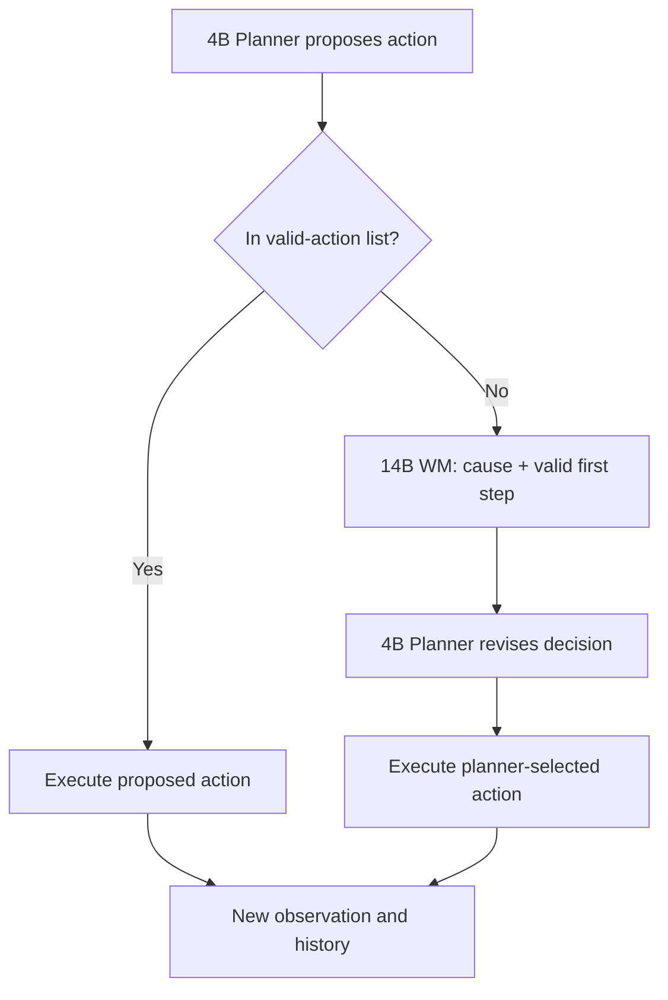

# From Prediction to Repair: A Frozen 14B World Model for a 4B Planner

CS5446 course project | Experiments through Oct 30, 2026 | Reorganized Nov 6, 2026 | @yuki

## Abstract

How should a stronger frozen world model help a fixed small planner? We study **Qwen3-4B-Instruct-2507 as the ReAct planner and Qwen3-14B as the world model (WM)** on ALFWorld. We consult the WM only when the planner proposes an action outside the environment's valid-action list. The WM explains the missing precondition and suggests one valid first step; the 4B planner retains the final decision. Both models are frozen, and repair uses no explicit rule base.

On 600 previously unrun tasks with three runs per arm, repair increases success from 20.9% to 36.2% (+15.3 percentage points, 95% CI [12.7, 17.8]). Progress improves by 4.2 points over failure notification and meets the pre-registered non-inferiority criterion against hand-written rule cards. With the same WM inputs and trigger, repair outperforms prediction by 4.1 points of progress. This report focuses on this fixed 4B-planner/14B-WM setting. Model-size comparisons, earlier routing studies and explicit-rule extensions are supplementary. These results do not establish an advantage over using the 14B model as the planner.

## 1. Background and research question

A ReAct planner alternates reasoning and actions using environment observations. ALFWorld tasks require locating objects, picking them up, satisfying appliance-related preconditions and placing objects at destinations. A planner may attempt an action from the wrong location or without holding the required object, receive "Nothing happens.", and repeat the action until its step budget is exhausted.

A world model can expose knowledge about action conditions. Predicting the next observation is one possible interface, but predicting "Nothing happens." does not explain how to recover. Earlier prediction and routing studies motivated targeting missing preconditions; their full results appear in Supplement A.

Our central question is: **can a frozen 14B WM improve a fixed 4B planner by explaining an infeasible action and suggesting a valid first step, while leaving action selection to the planner?** We test effectiveness against failure notification and reflection, compare repair with prediction under equal information, and evaluate against aligned WM and knowledge-based baselines.

Feedback and suggestions already appear in WALL-E-style methods. Our contribution is evidence about the failure trigger, the frozen rule-free setting and the repair interface, rather than the invention of WM feedback. The baseline mechanisms are described in Section 6; broader related-work context is retained in Supplement G.

## 2. Motivation and method

### 2.1 Why target infeasible actions?

On dev460 with two runs per task, 31.3% of the 4B planner's actions are invalid despite the valid-action list being present in its prompt. Among failed episodes, 74% end in a loop; 84% of heat, cool and clean attempts are invalid. These observations motivate intervention at local feasibility errors.

A fixed-trigger oracle probe on dev460 compares failure notification with the true missing precondition plus a valid first step. Success rises from 18.3% to 29.1%, and progress from 36.7% to 41.0%. The pre-registered progress contrast is +4.2 points [2.4, 6.0], Holm-adjusted p < 0.001. This demonstrates the potential value of repair information, not the performance of the 14B WM. Supplement A retains the full probe results.

### 2.2 Failure-triggered repair

At step t the planner proposes an action. If it is not in the valid-action list, the frozen WM receives the task, the history, the current observation, the valid actions and the failing action. It returns one sentence on the missing precondition and one valid first step (or "none"); a step outside the valid list is dropped. The planner is shown:

> Note: executing "take apple 1 from countertop 1" now would have no effect ("Nothing happens.") because you are already holding the tomato 2. To make progress toward it, first do: "move tomato 2 to countertop 1".

The planner then chooses the action to execute. The WM receives no explicit rule base; its suggested step is advisory and the planner selects the executed action. Otherwise the planner's action is executed unchanged, so the WM is called on roughly one step in four.

Valid actions run unchanged; only an infeasible proposal sends the step through the world model, and the planner still chooses what to execute.

### 2.3 Development and freeze

On dev460 × 2 (4B planner, PR, Holm over 4), 14B-WM repair beat generic reflection by +4.4 \[2.3, 6.4\], structured self-reflection by +5.1 \[2.9, 7.3\] and WM prediction at the same trigger by +7.1 \[5.1, 9.1\], and was level with hand-written rule cards (+1.3 \[−0.9, 3.5\]). The pre-registered freeze rule selected 14B-WM repair.

## 3. Experimental setup

The main experiments hold the 4B planner fixed and use a frozen 14B WM. Development and frozen-test results are reported separately.

**Environment.** ALFWorld (TextWorld), six task types, at most 30 steps per episode.

**Protocol (v2-list).** An AgentBoard-style ReAct prompt: task instruction, action templates, one in-context example of the same task type, the full history, and the list of currently valid actions at every step. The planner answers with `Thought:` and `Action:`. On a 102-task pilot this protocol raised the no-intervention success rate from 16.7% to 26.5% (McNemar p = 0.052), so all later studies use it.

**Models.** Planner: Qwen3-4B-Instruct-2507. WM: Qwen3-14B with thinking off. Both are frozen, with no fine-tuning. Controls without a WM retain the same 4B planner. Model-size comparisons are in Supplement B. Decoding: temperature 0, top-p 0.5, seed 42. Served with vLLM on Ascend 910B3 NPUs.

**Metrics.** SR = task success rate. PR = AgentBoard progress rate over subgoals (see the target, pick it up, the task-specific step); PR = 1 on success. Differences are in percentage points (pp).

| Task set | Content | Runs per arm | Use |
| --- | --- | --- | --- |
| dev460 | 460 training-split tasks | 2 | Development and method selection |
| **fresh600** | 600 training-split tasks never run before the method was frozen (100 per type), hash recorded | 3 | **Main evidence** |
| unseen134 | ALFWorld out-of-distribution split, used in earlier rounds | 5 | Repeated evaluation |
| label pool | 448 training-split tasks, disjoint from fresh600 | 2 | Learning rules and insights for baselines; calibration |

**Statistics.** Runs are averaged within each task; contrasts use a paired task bootstrap (20,000 resamples), so fresh600 has 600 units. Each family of primary contrasts is Holm-corrected; everything else is secondary and uncorrected. Hypotheses, freeze rules and test sets were pre-registered before the corresponding runs (Supplement H). Non-inferiority uses a margin of −2 pp on PR.

## 4. Main results: 4B Planner + 14B WM

Method, prompts, decoding, code and the test-set hash were frozen before the first fresh600 run.

| Arm | SR (%) | PR (%) |
| --- | --: | --: |
| None | 20.9 | 39.4 |
| Failure only | 28.3 | 44.8 |
| Generic reflection | 28.6 | 45.9 |
| Structured self-reflection | 23.7 | 42.8 |
| Hand-written rule cards | 33.3 | 46.8 |
| **WM repair, 14B WM (ours)** | **36.2** | **49.0** |
| Oracle repair | 36.7 | 47.5 |

| Pre-registered hypothesis (4B planner) | Estimate \[95% CI\] | Result |
| --- | --- | --- |
| H1: PR, ours − failure only | +4.2 \[2.6, 5.7\] | Supported, Holm p < 0.001 |
| H2: PR, non-inferior to rule cards (−2 pp) | +2.2 \[0.5, 3.9\] | Supported |
| H3: SR, ours − none | +15.3 \[12.7, 17.8\] | Supported, Holm p < 0.001 |

## 5. Interface ablations and mechanism

The gain comes from asking for a repair rather than a forecast; the suggested step does the work and the stated cause makes it usable.

### 5.1 Equal-information and output-component ablations

4B planner, frozen 14B WM, the same trigger, the planner always decides; fresh600 × 3, pre-registered.

| WM output shown to the planner | SR | PR | Same failure repeated / episode |
| --- | --: | --: | --: |
| (no WM) Failure only | 28.3 | 44.8 | 4.16 |
| Next-observation prediction | 24.1 | 42.4 | 5.15 |
| Prediction, WM given the same inputs as the repair prompt | 29.2 | 44.9 | 3.87 |
| Cause only | 29.7 | 45.6 | 4.24 |
| First step only | 32.2 | 47.0 | 3.76 |
| **Cause + first step (ours)** | **36.2** | **49.0** | **3.14** |

- Repair − prediction with equal information: PR +4.1 \[2.5, 5.7\], Holm p < 0.001. About 2.5 pp of the raw +6.6 gap came from the prediction prompt having less information; the rest is the question asked.
- Cause only − failure only: +0.8 \[−0.5, 2.1\], n.s. First step only − failure only: +2.2 \[0.6, 3.8\]. Cause + step − step only: +2.0 \[0.3, 3.6\].

### 5.2 Mechanism analysis

- **Where the gain lands.** Success after picking up the target rises from 0.44 (none) and 0.55 (failure only) to 0.66 with WM repair (oracle 0.71); finding the target barely changes.
- **Diagnoses need not be exactly right.** The WM's cause matches the environment-derived category in only 30% of trigger steps, yet the method is near the oracle. Useful guidance does not require an exact match to the diagnosis category, though this does not show that incorrect diagnoses are harmless. Episodes with mostly correct diagnoses still succeed more often (39.8% vs 28.4%, correlational).
- **Repair should not persist.** Keeping the last five diagnoses in every later prompt lowers SR by 4.4 pp \[2.3, 6.5\] (pre-registered): wrong details keep misleading later steps.
- Direct-execution and stronger-model takeover controls are reported in Supplement E.

The suggested step contributes more than the cause alone, whose incremental effect is not statistically significant. Their combination gives the strongest result among the tested interfaces.

## 6. Comparison with aligned baselines

All results here use the **4B planner**, with the frozen **14B model** for any WM or knowledge-learning role. Methods share the protocol and fresh600 evaluation (three runs per task). Learned knowledge uses the disjoint label pool. These are aligned re-implementations of selected mechanisms, not reproductions of the original systems. Trigger and information-access differences are stated below.

| Baseline | Implementation | Trigger |
| --- | --- | --- |
| WALL-E-style | WM judges each proposed action without the valid list; on predicted failure, Feedback + Suggestion, planner revises (≤ 2 times). With and without rules learned WALL-E-style (validation accuracy 0.68 → 0.79) | Every step |
| RPMS-style | Verb-relevant rule cards + belief state tracked from observations, rules first | Failure gate (as ours) |
| ExpeL-style | 15 insights distilled by the 14B model from the planner's own trajectories | Every prompt, or at the gate |
| WorldEvolver-style | WM forecasts every action; shown when confidence exceeds a threshold calibrated for \~30% use; optional episodic memory | Confidence gate |

| Arm (fresh600 × 3) | 4B SR | 4B PR | 14B calls / episode (4B) | Tokens / episode (4B) |
| --- | --: | --: | --: | --: |
| **Ours** | 36.2 | **49.0** | 5.3 | 47.8k |
| WALL-E-style | 26.8 | 48.2 | 54.5 | 118.2k |
| WALL-E-style + learned rules | 27.3 | 46.0 | 44.7 | 101.6k |
| RPMS-style | **37.2** | 48.1 | 0 | 42.6k |
| ExpeL-style, every step | 12.9 | 24.1 | 0 | 56.7k |
| ExpeL-style, at the gate | 28.1 | 43.4 | 0 | 52.2k |
| WorldEvolver-style gate | 22.1 | 41.4 | 25.9 | 88.7k |
| WorldEvolver-style gate + memory | 23.4 | 41.9 | 25.8 | 95.9k |

| Ours − baseline (PR, Holm within family) | 4B ΔPR | 4B ΔSR |
| --- | --- | --- |
| WALL-E-style | +0.7 \[−1.5, 2.9\], non-inferior | +9.4 |
| WALL-E-style + rules | **+2.9** \[0.9, 4.9\] | +8.9 |
| RPMS-style | +0.9 \[−0.8, 2.6\], non-inferior | −1.0 |
| ExpeL-style, every step | **+24.9** | +23.3 |
| ExpeL-style, at the gate | **+5.6** | +8.2 |
| WorldEvolver-style gate | **+7.6** \[5.8, 9.4\] | +14.2 |
| WorldEvolver-style gate + memory | **+7.0** | +12.8 |

Bold: Holm-adjusted p < 0.05. The WorldEvolver-style arms form their own pre-registered family.

The confidence-gated baseline uses about five times as many WM calls per episode as repair, yet achieves substantially lower success. Differences in trigger and information access are part of these system comparisons.

Repair has higher success than the WM-driven and experience-learned alternatives. Its progress is non-inferior to plain WALL-E-style judging and RPMS-style rules plus state under the specified margin; this does not establish equivalence or superiority on every metric.

## 7. Discussion and limitations

The equal-information comparison is central: at the same failure trigger, the same 14B WM helps the 4B planner more when asked for a repair than for a forecast. The method averages 5.3 WM calls per episode versus 54.5 for plain WALL-E-style judging and 25.9 for confidence-gated prediction. This is a call-count comparison with these implementations, not a general efficiency claim.

- **Environment access.** The trigger uses the environment-provided valid-action list before execution; it is not a learned failure detector. The list is also shown to the planner. A post-execution trigger retained about half the gain on dev460; a planner prompt without the list is untested.
- **Fixed-planner scope and cost.** A 14B planner alone reaches 59.1% success with 27.5k tokens per episode; 4B + 14B-WM repair reaches 36.2% with 47.8k. This setting is justified by studying guidance for a fixed small planner, not by evidence that it is the best model allocation.
- **Decision authority.** Allowing the 14B model to take over failing steps reaches 49.0% success. Restricting the main claims to planner-controlled decisions was a scope choice made after this result was known. The pre-registered takeover and direct-execution results remain in Supplement E.
- **Model capacity.** A 4B WM performs worse here, and its success advantage over failure notification is not significant (Supplement B). This supports the chosen 14B WM but does not establish a universal requirement that a WM must be larger than its planner.
- **Explicit knowledge.** Rule cards and the state tracker were written after failure analysis. The baselines are aligned re-implementations, not reproductions. Rule combinations and their limitations appear in Supplement D.
- **Generalization.** Evidence is limited to one environment and model family. fresh600 holds previously unrun instances from the training scene distribution, not an out-of-distribution split. Supplement F reports repeated unseen134 evaluation.
- **Provenance.** One frozen source file later gained control-arm code. The frozen version is archived and matches its pre-registered hash; the frozen method's code path is unchanged.

## 8. Conclusion

For a fixed 4B ReAct planner, a frozen 14B WM improves decisions by explaining an infeasible action and suggesting a valid first step. On fresh600, success rises from 20.9% to 36.2%. Equal-information ablations show that repair contributes beyond prediction, and cause plus step gives the strongest result among the tested interfaces. The evidence supports this repair interface when the small planner retains action selection and the WM receives no explicit rule base.

## Supplementary material

### A. Earlier prediction studies and diagnostic probes

Next-observation foresight has little decision value, and no way of timing it beat random timing. In every arm the WM predicts the next observation of the planner's proposed action, and the planner decides again with the prediction in its prompt. We varied when this happens: every step, WorldEvolver-style confidence gating, random 30% of steps, rule-, uncertainty- and learned gates, with and without episodic memory for the WM.

| Question | Evidence |
| --- | --- |
| Does selective foresight beat random selection? | unseen134: selective + memory SR +3.9 \[0.3, 7.6\] over none; random 30% +2.8; selective vs random +0.6 \[−2.7, 4.2\], n.s. |
| Do better predictions give better decisions? | Episodic memory raises prediction exact match from 37.7% to 60–62%, yet SR stays at 22.8% → 22.3% (dev600). A 14B WM predicts better than a 4B WM (token F1 +8 pp \[4, 12\]) but adds no decision value |
| Is foresight more than a second sample? | dev460, both planners, random 30% of steps: prediction minus a no-information resample is n.s. for both WMs. Only the true next observation helps, and only the 4B planner (PR +3.0 \[1.2, 4.8\]) |
| Can its value be predicted per state? | Same-state branching (K = 8 continuations): the gain over resampling is ≈ 0 on 501 4B states. A learned router's AUROC of 0.70–0.74 on 127 states fell to 0.42–0.43 on 374 new states |
| Does a stronger WM rescue confidence gating? | fresh600, 14B WM, gate open on 28–31% of steps: 4B 22.1 / 41.4 vs none 20.9 / 39.4 (SR / PR); 14B 61.0 / 72.2 vs 59.1 / 70.3 |

**Finding 1.** Conventional next-observation guidance has limited and unstable value, and prediction accuracy is not decision utility. Selective invocation does not reliably beat matched random selection, so the pre-registered router line was stopped. If the forecast itself carries little information, timing it better cannot help; the next question is what information the planner lacks.

The planner lacks action feasibility, and telling it why an action fails helps far more than telling it what will happen.

#### A.1 Failure analysis

No-intervention runs on dev460, two runs per task:

| Signal | 4B planner | 14B planner |
| --- | --: | --: |
| Actions not in the valid-action list shown in the prompt | 31.3% | 17.4% |
| Failed episodes ending in a loop (≤ 4 distinct actions in the last 10) | 74% | 37% |
| Success after picking up the target object | 0.27 | 0.77 |
| Heat / cool / clean attempts that are invalid | 84% | — |

Most invalid heat, cool and clean attempts are made away from the appliance or without holding the object, and are then repeated. The bottleneck is local feasibility after the object is picked up, not long-horizon prediction.

#### A.2 Oracle probes at a fixed trigger

We fix one trigger: intervene only when the proposed action is not in the valid-action list (about a quarter of steps). Only the information given for the planner's second decision changes (dev460 × 2, 4B planner).

| Information at a failure step | SR | PR |
| --- | --: | --: |
| None | 11.7 | 32.8 |
| Resample (same prompt, T = 0.7) | 14.9 | 35.0 |
| Failure only ("this action would have no effect") | 18.3 | 36.7 |
| Legal projection (action constrained to valid ones) | 14.2 | 36.2 |
| **Oracle repair** (true cause from tracked state and action rules, plus a valid first step) | **29.1** | **41.0** |

For an invalid action the true next observation is "Nothing happens.", so the failure notice is exactly the oracle prediction at this trigger. Pre-registered contrasts (PR, Holm over 3): repair − failure +4.2 \[2.4, 6.0\], repair − projection +4.7 \[2.4, 7.0\], all p < 0.001.

**Finding 2.** The planner's bottleneck is missing preconditions. At the same trigger, a diagnosis of why the action fails and what to do first is worth far more than a perfect forecast. This sets the target for the main repair study: can a frozen WM produce that diagnosis?

### B. Model-size controls and 14B-planner evaluation

Earlier prediction experiments tested two planners with two WMs. The final repair evaluation includes 4B + 4B, 4B + 14B, and 14B + 14B; it is not a full 2-by-2 repair matrix. For the 4B planner, the 4B-WM success advantage over failure notification is +1.3 points [-0.9, 3.7], p = 0.249 (secondary, uncorrected).

Method, prompts, decoding, code and the test-set hash were frozen before the first fresh600 run.

| Arm | 4B SR | 4B PR | 14B SR | 14B PR |
| --- | --: | --: | --: | --: |
| None | 20.9 | 39.4 | 59.1 | 70.3 |
| Failure only | 28.3 | 44.8 | 63.9 | 72.8 |
| Generic reflection | 28.6 | 45.9 | 64.9 | 73.5 |
| Structured self-reflection | 23.7 | 42.8 | 65.4 | 74.0 |
| Hand-written rule cards | 33.3 | 46.8 | 68.8 | 76.0 |
| WM repair, 4B WM | 29.7 | 46.6 | — | — |
| **WM repair, 14B WM (ours)** | **36.2** | **49.0** | 65.9 | 74.3 |
| Oracle repair | 36.7 | 47.5 | 69.5 | 76.6 |

| Pre-registered hypothesis (4B planner) | Estimate \[95% CI\] | Result |
| --- | --- | --- |
| H1: PR, ours − failure only | +4.2 \[2.6, 5.7\] | Supported, Holm p < 0.001 |
| H2: PR, non-inferior to rule cards (−2 pp) | +2.2 \[0.5, 3.9\] | Supported |
| H3: SR, ours − none | +15.3 \[12.7, 17.8\] | Supported, Holm p < 0.001 |

On unseen134 × 5 the direction agrees: 4B SR 38.5 for ours vs 25.4 for none (+13.1 \[8.7, 17.8\]) and 34.9 for rule cards. A 4B WM gives 6.6 SR less than the 14B WM, supporting the larger WM in this setting.

**Finding 3.** A frozen WM asked for a diagnosis and a first step, only at infeasible actions, gives a weak planner nearly all the value of an oracle diagnosis and at least the value of hand-written rules, without a rule base. For a 14B planner it still helps (+6.8 SR over none) but trails rule cards (Supplement D returns to this).

### C. Baselines for both planner sizes

For the 4B planner our method is ahead of every world-model-driven and experience-learned alternative on success rate (on progress, level with plain WALL-E-style judging) and ties the hand-built rules-plus-state system; for the 14B planner only that hand-built system is better. Every baseline uses the same planners, the same frozen 14B model for any WM or knowledge role, the same protocol and the same fresh600 × 3 episodes. Knowledge is learned only from the label pool. All families were pre-registered.

| Baseline | Implementation | Trigger |
| --- | --- | --- |
| WALL-E-style | WM judges each proposed action without the valid list; on predicted failure, Feedback + Suggestion, planner revises (≤ 2 times). With and without rules learned WALL-E-style (validation accuracy 0.68 → 0.79) | Every step |
| RPMS-style | Verb-relevant rule cards + belief state tracked from observations, rules first | Failure gate (as ours) |
| ExpeL-style | 15 insights distilled by the 14B model from the planner's own trajectories | Every prompt, or at the gate |
| WorldEvolver-style | WM forecasts every action; shown when confidence exceeds a threshold calibrated for \~30% use; optional episodic memory | Confidence gate |

| Arm (fresh600 × 3) | 4B SR | 4B PR | 14B calls / episode (4B) | Tokens / episode (4B) | 14B SR | 14B PR |
| --- | --: | --: | --: | --: | --: | --: |
| **Ours** | 36.2 | **49.0** | 5.3 | 47.8k | 65.9 | 74.3 |
| WALL-E-style | 26.8 | 48.2 | 54.5 | 118.2k | 55.0 | 69.4 |
| WALL-E-style + learned rules | 27.3 | 46.0 | 44.7 | 101.6k | 54.4 | 68.8 |
| RPMS-style | **37.2** | 48.1 | 0 | 42.6k | **70.7** | **77.0** |
| ExpeL-style, every step | 12.9 | 24.1 | 0 | 56.7k | 53.2 | 63.4 |
| ExpeL-style, at the gate | 28.1 | 43.4 | 0 | 52.2k | 64.1 | 72.3 |
| WorldEvolver-style gate | 22.1 | 41.4 | 25.9 | 88.7k | 61.0 | 72.2 |
| WorldEvolver-style gate + memory | 23.4 | 41.9 | 25.8 | 95.9k | 59.8 | 71.3 |

| Ours − baseline (PR, Holm within family) | 4B ΔPR | 4B ΔSR | 14B ΔPR | 14B ΔSR |
| --- | --- | --- | --- | --- |
| WALL-E-style | +0.7 \[−1.5, 2.9\], non-inferior | +9.4 | **+4.9** | +10.9 |
| WALL-E-style + rules | **+2.9** \[0.9, 4.9\] | +8.9 | **+5.5** | +11.4 |
| RPMS-style | +0.9 \[−0.8, 2.6\], non-inferior | −1.0 | **−2.6** \[−3.9, −1.3\] | −4.8 |
| ExpeL-style, every step | **+24.9** | +23.3 | **+10.9** | +12.7 |
| ExpeL-style, at the gate | **+5.6** | +8.2 | **+2.1** | +1.8 |
| WorldEvolver-style gate | **+7.6** \[5.8, 9.4\] | +14.2 | **+2.1** | +4.9 |
| WorldEvolver-style gate + memory | **+7.0** | +12.8 | **+3.0** | +6.1 |

Bold: Holm-adjusted p < 0.05. The WorldEvolver-style arms form their own pre-registered family.

**Why WM-judged triggers lose.** The WALL-E-style WM rejects at least once in 34–65% of steps, and 44–67% of its rejections hit actions that were in fact valid. For the 14B planner, which makes fewer real errors, these false alarms push success below no intervention. The confidence gate opens on target, yet stays near no intervention at five times our WM calls.

**Finding 5.** Where the failure signal comes from matters as much as what the WM says. Guidance anchored to an environment-observable failure is cheaper (5.3 vs \~50 WM calls per episode) and more accurate than WM-judged checking or confidence-gated foresight. Against explicit knowledge, a frozen WM matches hand-built rules plus state for the weak planner and beats rules or insights learned automatically from experience.

### D. Rule-based extensions and capability boundary

A strong planner's remaining gap is a few specific rules the WM does not recover; adding those rules closes it, and how they are added does not matter.

#### D.1 Where the 14B planner falls short

For the 14B planner the gap to rule cards sits mostly in pick\_two\_obj (SR 44.7 for ours vs 57.3 for rule cards and 64.0 for RPMS-style). The rule card for `take` states that the agent can carry one object at a time; the WM rarely recovers this, and "already holding" failures recur. Oracle state facts alone do not help the 14B planner, so the gap is a missing rule, not state tracking. The two knowledge sources are complementary by task type: ours leads on look\_at, clean and cool for the 4B planner; RPMS-style leads on heat and pick\_two\_obj for both planners.

#### D.2 Does checking the WM with rules help? (pre-registered)

We kept the planner's role and the WM's first call, and added a small rule set only to check the WM's diagnosis. A symbolic check compares the WM's cause and step with the rule cards and a belief state tracked from the history. On a conflict (about 57% of trigger steps) the WM is asked once more with the rule and the tracked facts; the planner sees only the WM's answer. The control, *concat*, shows the planner the unchanged WM repair followed by the RPMS-style rules and state, without any check. A variant with WALL-E-style learned rules failed dev selection: its rules are too generic and miss the carry-one constraint.

| Arm (fresh600 × 3) | 4B SR | 4B PR | 14B SR | 14B PR | 14B calls / episode (4B) |
| --- | --: | --: | --: | --: | --: |
| Ours (WM repair) | 36.2 | 49.0 | 65.9 | 74.3 | 5.3 |
| RPMS-style | 37.2 | 48.1 | 70.7 | 77.0 | 0 |
| Concat: WM repair + rules and state | 37.8 | 49.2 | 70.6 | 77.0 | 4.7 |
| WM repair checked by rules | 38.9 | 49.4 | 71.0 | 77.0 | 7.2 |

| Hypothesis (PR, Holm over 3 per planner) | 4B | 14B |
| --- | --- | --- |
| H1: checked > ours | +0.4 \[−1.0, 1.8\], not supported | **+2.6** \[1.4, 3.9\], supported (SR +5.1) |
| H2: checked > concat | +0.1 \[−1.4, 1.7\], not supported | −0.0 \[−1.3, 1.2\], not supported |
| H3: checked non-inferior to RPMS-style | +1.3 \[−0.4, 3.1\], supported | +0.0 \[−1.2, 1.2\], supported |

The re-ask does correct the WM: its cause agrees with the rule-derived category 36% → 78% (4B) and 18% → 65% (14B). Yet the planner does equally well when it receives the rules next to the uncorrected repair. On dev460 the checked variant looked better than concat for the 4B planner (+1.9 PR); that gap vanished on fresh600, a reminder of why selection and testing used separate task sets.

**Finding 6.** WM repair and explicit rules are complementary knowledge sources; combined, they close the strong planner's gap (14B: +2.6 PR over WM repair alone, level with RPMS-style). Verifying the WM with the rules adds nothing over showing both. With hand-written rules available, the rules plus state alone already reach the same level at no WM cost, so WM repair is most valuable where no rule base exists.

### E. Arms outside the planner-decides setting

Two pre-registered arms let the WM determine the executed action. They are reported in full because they were pre-registered; excluding them from the main claims is a scope decision made after the results were known.

| Arm (fresh600, 4B planner) | SR | PR | Pre-registered test |
| --- | --: | --: | --- |
| Ours (planner decides) | 36.2 | 49.0 | — |
| Execute the WM's first step directly | 36.9 | 49.2 | vs ours: PR +0.2 \[−1.4, 1.8\], n.s. |
| The 14B model decides the failing step (takeover) | 49.0 | 58.3 | ours − takeover: PR −9.4 \[−11.7, −7.2\] |

The takeover result means the repair interface cannot be claimed as better than simply letting a stronger model act; our claims are restricted to the setting in which the planner keeps the decision.

### F. Repeated unseen134 evaluation

With the 4B planner on unseen134 (five runs per task), 14B-WM repair reaches 38.5% success versus 25.4% without intervention (+13.1 points [8.7, 17.8]) and 34.9% with rule cards. The direction agrees with fresh600. Because unseen134 was used in earlier rounds, fresh600 remains the principal frozen-test evidence.

### G. Related-work context retained from the original report

Our method differs from the closest work in its trigger and its knowledge source, not in the form of its output.

| Work | What the WM or knowledge source provides | Trigger | Relation to ours |
| --- | --- | --- | --- |
| WorldEvolver (arXiv 2606.30639) | Next-observation foresight, episodic memory, heuristic rules | Confidence-gated | Study 1 baseline; re-run with our 14B WM in Section 6 |
| WALL-E, WALL-E 2.0 (arXiv 2410.07484, 2504.15785) | Success/failure judgement; on predicted failure, rule-based Feedback and a Suggestion | Every proposed action | Closest work; same output form, but the WM judges every step and rules are learned. Re-implemented in Section 6 |
| RPMS (arXiv 2603.17831) | Rule retrieval plus a lightweight belief state, rules first | At failures | Strongest explicit-knowledge rival; re-implemented in Section 6 |
| ExpeL (AAAI 2024), AutoManual (NeurIPS 2024) | Rules or insights learned from experience | Every prompt | ExpeL-style baseline in Section 6 |
| WKM (NeurIPS 2024) | Trained world-knowledge model supplying task and state knowledge | Every step | Requires training; discussed only |
| AEWM (arXiv 2609.28416), AAWM (arXiv 2606.25421) | WMs trained to model decision-relevant dynamics | — | Agree with our negative result on foresight; require training |
| Guan et al. (NeurIPS 2023) | LLM-built PDDL domain models (preconditions and effects) for classical planners | — | Preconditions are WM knowledge by definition |
| Reflexion and self-reflection | The agent reasons about its own failure | After failure | Generic and structured reflection are our controls |

**Positioning.** All our models are frozen, and our claims concern the interface between a frozen WM and a frozen planner: under one trigger and one model, which information helps, and how far it can replace an explicit or learned rule base. Details of WKM, AEWM and AAWM come from summaries and should be checked against the full papers before submission.

### H. Pre-registrations

All under `outputs/react_study/` in the project repository.

| File | Content | Outcome |
| --- | --- | --- |
| `dirF_final_eval/tables/preregistration.json` | Gating and interface hypotheses (Study 1) | Not supported |
| `p3_mechanism_matrix/tables/preregistration_p3.json` | Prediction vs resampling, 2 planners × 2 WMs | Only 4B oracle − resampling |
| `probe_feasibility/tables/preregistration_probe.json` | Oracle repair probes | Supported |
| `probe_feasibility/tables/preregistration_round5A.json` | Method freeze rule | Froze 14B-WM repair |
| `p7_final/tables/preregistration_round5_final.json` | H1–H3 on fresh600 | All supported |
| `p7_final/tables/preregistration_confounds.json` | Interface and takeover controls | Equal-information repair > prediction supported; takeover higher (Supplement E) |
| `p7_final/tables/preregistration_followups.json` | Direct execution, repair memory | Neither supported; memory harmful |
| `r6_baselines/tables/preregistration_baselines.json` | WALL-E-, RPMS-, ExpeL-style baselines | See Section 6 and Supplement C |
| `r6_baselines/tables/preregistration_selective.json` | WorldEvolver-style confidence gate | Ours better for both planners |
| `r7_hybrid/tables/preregistration_r7.json` | WM repair checked by rules | 14B H1 and H3 supported; H2 not supported |

### I. Evidence and code

| Section | Files (under `outputs/react_study/`) |
| --- | --- |
| Earlier prediction studies (Supplement A) | `step4_unseen_test/`, `step2_episodic_memory/`, `p3_mechanism_matrix/`, `p4_router/`, `p2_branch_labels/` |
| Diagnostic probes (Supplement A) | `failure_analysis/tables/failure_analysis.md`, `probe_feasibility/tables/probe_4b.md` |
| Main repair evaluation | `probe_feasibility/tables/round5A.md`, `p7_final/tables/final_fresh600.md`, `p7_final/tables/final_unseen134.md`, `p7_final/tables/confounds_followups.md` |
| Mechanism | `failure_analysis/tables/deep_analysis.md` |
| Baselines | `r6_baselines/README.md`, `r6_baselines/tables/baselines_fresh600.md` |
| WM + rules | `r7_hybrid/README.md`, `r7_hybrid/tables/dev_r7.md`, `r7_hybrid/tables/fresh_r7.md` |
| Code | `preexperiments/react_study/` (`agent.py`, `preconditions.py`, `baselines_r6.py`, `hybrid_r7.py`, analysis scripts) |
