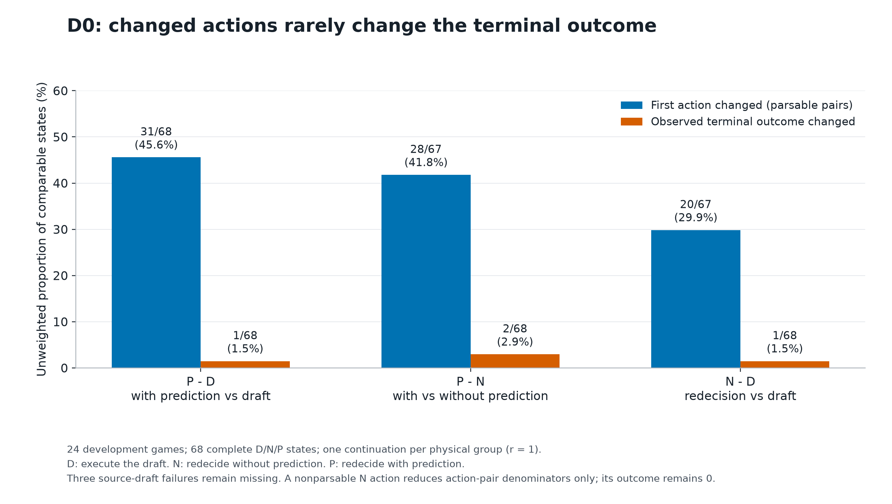
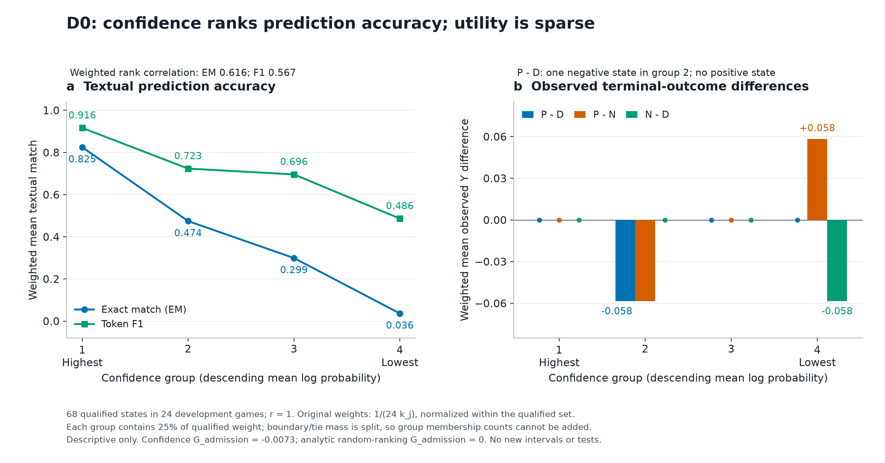
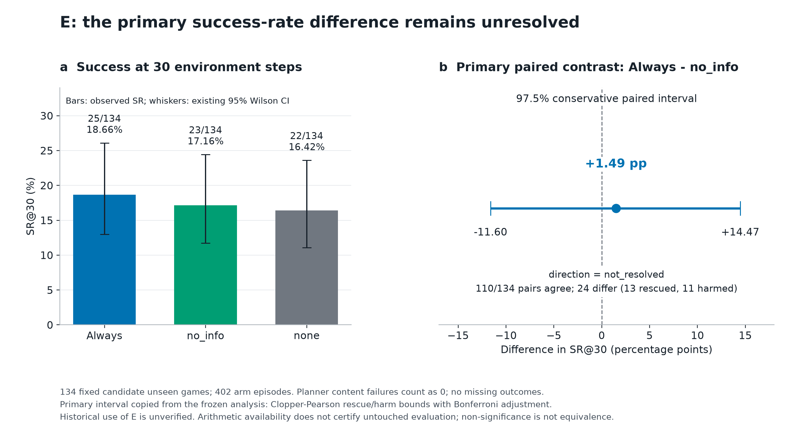
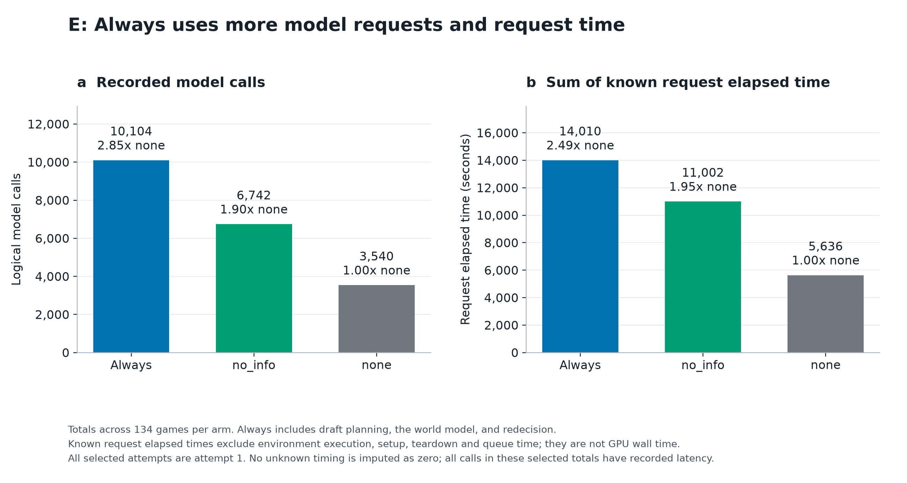

# Confidence 能否识别有用的 Foresight？4B 测量研究、负结果与机制诊断（draft）

本研究以 ALFWorld 中固定的 Qwen3-4B ReAct Planner 与一步 World Model（WM）为对象，测量预测准确性、局部决策效用和整局任务表现。主要发现是：**confidence 能排序预测准确性，但动作改变很少转化为终局改变。** D0 的 68 个完整状态中，confidence 与 EM、token-F1 的加权秩相关分别为 0.616、0.567；带预测再决策相对原 draft 改变了 31/68 个首动作，而 P−D 仅在 1/68 个状态非零。局部观测效用近乎退化，使当前开发数据无法可靠辨识 confidence 的稳定效用排序能力。E 的 134 个固定候选游戏上，Always、no_info、none 的 SR@30 分别为 18.66%、17.16%、16.42%；主对比 Always − no_info 为 +1.49 个百分点，预定 97.5% 区间为 [−11.60, +14.47] 个百分点，方向未定。Always 的调用量约为 none 的 2.9 倍、no_info 的 1.5 倍。效用稀疏、收益方向未定与已记录的额外成本共同构成本配置下的测量发现；按 proposal 预设条件，Utility Gate 学习分支未触发。

这里的“基线”是项目已完成的 4B 测量交付，不是 32B 模型性能的统计下界。数据、指标和本次分析结果沿用已有冻结版本；本文仍是供课程写作使用的 draft，正式 AI 使用声明待课程格式提供。报告不依赖 32B 取得正向结果，也不把 D0 或 E 写成已经完成 D1 独立验证。

## 1. 问题与动机

预测模型对自己输出的 confidence，衡量的是预测本身的可信程度；是否把这段预测交给 planner，则是一个干预问题。准确描述下一步观察，不一定改变动作；改变动作，也不一定改变剩余策略下的任务结果。因此本研究分别测量“预测是否准确”“提供预测是否改变决策与终局”和“整局持续提供预测是否值得其成本”，不把它们当成同一个目标。

项目按方法论测量研究组织。D/N/P 分解用于拆开“再想一次”与“加入预测信息”的作用，E 的预注册三臂配对设计用于测量整局收益和成本。D0 中极少出现非零局部效用，本身就是主要经验发现：它揭示了本配置下可供 gating 排序的观测信号有多少，而不是将没有训练 Gate 写成方法失败。proposal 明确保留了在学习缺乏支持时交付 measurement study 的路径，见第 4.2 节。

| 数据阶段 | 回答的问题 | 本报告中的位置 |
| --- | --- | --- |
| D0 | 同一状态下，再决策和预测信息如何改变动作及后续结果；confidence 与预测准确性、观测效用有何关系 | 已完成的开发期描述 |
| D1 | 在独立局部验证数据上检验预先固定的 confidence 与效用关系或排序规则 | 本轮没有 D1 执行或验收；不宣称完成 |
| E | 在整局中持续采用不同策略，成功率和成本如何变化 | 已完成 Aim 3 三臂评估与一次预定合并分析；历史资格未核实 |

D1 和 E 对应不同的实验单位和干预方式，E 完成不能补作 D1 验证。原交接将 D1 列为尚未完成的独立局部验证任务；本轮执行记录仅涉及 E。[研究阶段定义](https://github.com/YokilyHIT/cs5446/blob/gpu/gpu_analysis/docs/RESEARCH_PROTOCOL.md?plain=1#L56)

## 2. 相关工作

[ReAct](https://arxiv.org/abs/2210.03629) 将推理与环境动作交替生成；[ALFWorld](https://arxiv.org/abs/2010.03768) 提供文本与具身任务对齐的交互环境，本研究只使用其文本接口。[WorldEvolver](https://arxiv.org/html/2606.30639v2) 通过记忆更新改善一步预测，并按生成 token 的几何平均概率筛选预测；[CoMAP](https://arxiv.org/html/2606.02372v2) 将预测反馈用于动作反思，并共同改进策略与世界模型。这些机制促使我们检验：预测是否准确，与提供预测是否改善决策，是否可以由同一个 confidence 分数识别。

[Kadavath 等](https://arxiv.org/abs/2207.05221) 研究模型对答案正确性和可回答性的自我评估，其概率定义与本文的生成 token 分数不同，不能直接作为本分数已校准或能排序干预效用的证据。本文固定模型与解码配置，用 D/N/P 和 none/no_info/always 分别隔离局部与整局中的再决策及信息作用；不包含 WorldEvolver 的记忆机制或 CoMAP 的共同演进训练，因此不构成这两套完整方法的复现或否定，也不直接比较不同配置下的论文成绩。

[Math-Shepherd（Wang 等，ACL 2024）](https://aclanthology.org/2024.acl-long.510/) 从中间推理步骤生成多条后续解答，以最终答案是否正确构造过程监督：软标签为正确续解的比例，硬标签表示是否至少存在一条正确续解。它测量给定 completer 下的续解潜力，而非两种干预的净收益。本文 D0 则对同一状态比较 D/N/P 分支，每物理组仅作一次贪心续跑（r=1），得到该配置下的单次结果差异，不将其解释为多次采样估计的成功期望。

## 3. 方法

### 3.1 固定配置

Planner 和 WM 均使用 Qwen3-4B-Instruct-2507，profile 为 `react_single_env_action_v1`。配置固定为 seed 42、temperature 0、top_p 0.5、history 50、无 memory，planner/WM 输出上限分别为 384/256 tokens，动作预算 H=30。

### 3.2 D/N/P 局部干预

D0 从 None 策略访问的预选状态恢复，比较三个局部分支：D 执行原 draft；N 不看预测再次决策；P 看预测再次决策。干预只发生在当前步，之后三分支均使用同一无预测策略继续，剩余动作预算为 30−t，包含干预动作。每物理组只续跑一次（r=1），共享物理续跑不增加独立样本。

D0 包含 24 个开发游戏、71 个预选状态，其中 68 个具有完整 D/N/P 结果，形成 117 个物理续跑组；另有 3 个源 draft 失败。每点保留原权重 `1/(24 × original_k_j)`，各指标仅在自己的合格集合内整体归一，不按筛选后每游戏剩余状态数重新赋权。完整交集的原权重覆盖为 0.9513888889；源失败的局部 Y、confidence、accuracy 和效用保持缺失，71 点全计划均值不补零。

### 3.3 E 三臂整局评估

E 在每个游戏中分别执行 none、no_info、always 三个整局策略。主对比为 Always − no_info，用来区分预测信息与额外再决策；另外两个对比为描述性分析。与 none 的对比包含额外 planner 调用带来的成本和失败机会。[冻结 E 方法](https://github.com/YokilyHIT/cs5446/blob/gpu/aim3_e/plan/EVALUATION_PLAN.md)

E 固定为 `eval_out_of_distribution` 清单中的 134 个候选游戏，每游戏等权，每臂一次，SR@30 为主指标。policy failure 与预算耗尽计 0，技术缺失保持 null。主对比直接复用 `paired_study_comparison`：救回/伤害率的 Clopper–Pearson 区间经 Bonferroni 合成预定 97.5% 差值区间。方向只由该区间的 `direction` 字段判定，McNemar p 作为补充，不选择更有利的判据。缺失任何计划配对时，按冻结规则暂停主点估计和推断，不静默转为完整案例分析。

## 4. 结果

### 4.1 Aim 1：准确性可排序，局部终局差异稀疏

| 局部结果 | 不加权成功状态数 | 可用交集加权成功均值 |
| --- | --- | --- |
| D | 9/68 | 0.1313868613 |
| N | 8/68 | 0.1167883212 |
| P | 8/68 | 0.1167883212 |

单次观测差的加权均值为 admission（P−D）= −0.01459854015、info（P−N）= 0、revision（N−D）= −0.01459854015。T=0 下续跑按非采样的贪心策略设计；68 个可用状态的 D 重放已核对，N/P 的独立复现抽查未完成。因此这里报告的是该贪心配置下的单次结果，不是对随机采样策略取平均得到的效用估计。P−D 在 67 个状态为 0、1 个状态为 −1；P−N 在 66 个状态为 0、各有 1 个 +1 和 −1；N−D 在 67 个状态为 0、1 个状态为 −1。两个终局差异状态来自同一游戏；其中 P−N 的正差包含一次 N 首动作格式失败。不能由这些稀疏观测推出 WM 普遍无用或真实效用为零。

在双方首动作可解析的比较中，P 相对 D 改变动作 31/68 次（45.6%，约 46%），N 相对 D 改变动作 20/67 次，P 相对 N 改变动作 28/67 次；相应的终局结果仅在 1/68（1.5%）、1/68、2/68 个状态不同。一条 N 首动作解析失败仍保留其终局失败 Y=0，但不进入需要双方动作可解析的分母。原权重下可解析交集的动作改变比例分别为 0.4526、0.2963、0.4148；这些加权比例与直接计数的比例口径不同。**决策改变不等于结局改变**，是本 D0 样本的核心经验发现。



图 1 按非加权计数显示变化比例，柱上保留分子和分母。动作变化中涉及 N 的分母为 67，终局比较为 68；3 个源失败保持缺失。这里的“终局改变”是两分支结果不一致，不等于净收益，也不把状态视为独立游戏。

预测的加权 EM 为 0.4087591241、token-F1 为 0.7055986218；参考是 D 实际执行原 draft 后的第一步观察。confidence 使用原 mean logprob 排序，展示用 exp 分数不是校准后的成功概率，EM/F1 也只是文本匹配代理。按冻结定义，confidence 与 EM、token-F1 的加权秩相关分别为 **0.616092、0.566795**。这里的秩相关是先取普通平均秩，再算加权 Pearson；精确同分取平均秩，不附加确认性区间或 p 值。

按 confidence 从高到低分为四组，各占合格原权重的 25%；边界状态按比例分权，不能把组内参与点数相加当作新的独立样本：

| Confidence 组（高→低） | 加权 EM | 加权 token-F1 | 观测 admission（P−D） | 观测 info（P−N） | 观测 revision（N−D） |
| --- | --- | --- | --- | --- | --- |
| Q1 | 0.825 | 0.916 | 0 | 0 | 0 |
| Q2 | 0.474 | 0.723 | −0.05839 | −0.05839 | 0 |
| Q3 | 0.299 | 0.696 | 0 | 0 | 0 |
| Q4 | 0.036 | 0.486 | 0 | +0.05839 | −0.05839 |

该表显示 confidence 能在本样本中区分文本预测的准确程度：EM 从最高组的 0.825 降至最低组的 0.036。另一方面，几乎没有非零 admission 效用可供排序；唯一 P−D = −1 的状态落在 Q2，没有观测到 P−D > 0 的状态。info 的正、负差则分别在 Q4、Q2，三种效用不能混为一谈。这回答了研究问题中准确性的一半，也说明当前样本为何不足以回答稳定的效用排序问题。

冻结的 admission 排序描述量为 `G = Σ normalized_w × (g − 0.5) × observed_U_admission`，其中 g 表示按 confidence 选择前 50% 原权重的归属，边界可分权。其结果为 **−0.007299**，同覆盖率的解析 Random 基准为 **0**。G 数值接近零，但不与 Random 数值相等，也没有经过等价检验；该微小负值由唯一负 admission 状态落入前半权重驱动。这不是前半组效用均值、整局 SR 增益或正式 C 上界。两个终局差异状态集中在同一游戏，逐游戏删除该游戏后三种观测效用均为零。

**开发数据中，confidence 与预测准确性有较强的描述性关联，但单步干预几乎不改变终局，局部观测效用近乎退化，因此当前数据无法可靠辨识 confidence 的稳定效用排序能力。** 这里的“无法辨识”指可排序的观测差异不足，不能据此确认稳定关系；它不表示理论上不可识别，也不表示已经证明 confidence 不能排序效用。D1 未执行，不能作确认性 gating 结论。



图 2 左侧是同一组 68 个合格状态按原权重分组的 EM/F1，右侧分别显示 admission、info、revision 的单次观测均值。各组占合格权重 25%，边界按比例分权；图示相关与 G 均来自既有描述输出，没有新增推断。

一个按固定规则选出的案例中，WM 正确预测了咖啡机处的空观察，但 D/N/P 最终都因预算耗尽失败。该案例展示了“预测正确”和“任务完成”之间的差别；它本身不能证明失败的因果机制。完整报告同时保留跨作业敏感性、逐游戏删除分析和物理路径记录。[完整 D0 报告](https://github.com/YokilyHIT/cs5446/blob/gpu/gpu_analysis/checkpoints/d0_report.md)

D0 的独立 N/P 抽查在该报告快照中仅完成候选准备：6 组、6 游戏、83 次原新 μ 调用，不写作复现已通过。历史中断尝试存在缺失的调用终端记录，已知 token 和请求时间只能作为覆盖范围内的小计，未知量不补零，也不把请求时间换成完整 GPU 墙钟。

### 4.2 Aim 2：按预设条件未触发 Gate 学习

proposal 将 Utility Gate 设为有条件的学习任务：标签可靠、效用存在可预测的变化且资源许可时，才训练小型 admission-utility 模型；其交付路径明确写明 “If learning is unsupported, deliver the measurement study.”。Aim 2 条件（proposal 第 2 节 Aim 2）、交付约定（proposal 第 5 节 Risks and Mitigations）

D0 的 P−D 仅在 1/68 个状态非零，未建立稳定可预测的 admission 信号，N/P 复现抽查亦未完成。本轮因此采用预定的 measurement study 交付路径：**Utility Gate 学习分支未触发，没有训练或验证 Gate**。这里不是声称某个已训练 Gate 检验失败，也没有把 1/68 事后改成预注册的数值阈值，更不能将其当作 `C<2.5pp` 的正式认证。D1 的独立局部验证仍是未完成事项，与 Aim 2 的条件式交付区别记录。

### 4.3 Aim 3：E 整局成功率

最终分析状态为 `complete`，10 个分片均选择 attempt 1，共 134 个游戏、402 条游戏–策略记录；无技术缺失、未运行或重跑。以下数值均来自唯一一次最终 [analysis.json](https://github.com/YokilyHIT/cs5446/blob/gpu/aim3_e/results/analysis.public.json)，这里只做单位换算和显示舍入，未追加统计分析。完整性认证表示输出、身份和审计可复算，不表示策略有效。[E 执行记录](https://github.com/YokilyHIT/cs5446/blob/gpu/aim3_e/results/E_RUN_STATUS.public.md)

| 策略 | 成功游戏 / 计划游戏 | SR@30 | policy failure 游戏 / 计划游戏 |
| --- | --- | --- | --- |
| Always | 25/134 | 18.66% | 19/134（14.18%） |
| no_info | 23/134 | 17.16% | 22/134（16.42%） |
| none | 22/134 | 16.42% | 11/134（8.21%） |

| 配对对比 | 差值（百分点） | 差值区间（百分点） | rescued / harmed | 精确双侧 McNemar p |
| --- | --- | --- | --- | --- |
| Always − no_info，唯一主对比 | +1.49 | 97.5%：[−11.60, +14.47] | 13 / 11 | 0.83882 |
| Always − none，描述性 | +2.24 | 95%：[−8.52, +12.84] | 11 / 8 | 0.64761 |
| no_info − none，描述性 | +0.75 | 95%：[−9.00, +10.43] | 8 / 7 | 1.00000 |

rescued 指前者成功而后者失败，harmed 指前者失败而后者成功。Always 与 no_info 在 **110/134 局（82.09%）**结果相同，只有 **24 局**不一致，其中救回 13 局、伤害 11 局。该一致性计数来自 `134 − 13 − 11`，不增加新的检验。它与 D0 的稀疏终局变化形成描述性呼应，但局部单步干预和整局持续策略的单位与干预强度不同，不能据此推导同一个因果机制。

主区间的 `direction=not_resolved`，因此不能将正点估计写成已确立的优势。在预定 iid 游戏配对模型下，97.5% 区间排除了高于 +14.47 个百分点的收益和低于 −11.60 个百分点的差值，但仍容许区间内有意义的正、负差异。本次观察不足以判定方向；这些端点不是本设计的最小可检测效应，也不意味着所有更小的差异在任何样本中都无法检出。不显著不等于等价。



图 3 左侧显示各臂 SR@30 及既有描述性 95% Wilson 区间；右侧显示唯一主对比 Always − no_info 的预定 97.5% 配对差值区间。主结论由右侧区间判定，不由左侧区间是否重叠判定。两种水平与用途不同，均未重新计算或另行选择。

按预定规则，另列双臂均无 policy failure 的配对子集。各对比保留的游戏不同，且筛选发生在处理后；下表仅描述这些子集，不能替代全 134 对主结果或解释为“无失败时的因果效应”。

| 配对子集 | 保留 / 原计划 | 排除数 | 差值（百分点） | 描述性 95% 区间（百分点） |
| --- | --- | --- | --- | --- |
| Always − no_info | 95/134 | 39 | +2.11 | [−13.07, +17.08] |
| Always − none | 107/134 | 27 | +4.67 | [−8.05, +16.98] |
| no_info − none | 103/134 | 31 | 0.00 | [−11.40, +11.40] |

### 4.4 E 的失败诊断

失败诊断按实际 planner 调用暴露列出，分母与上面的游戏级失败率不同：

| 策略与决策角色 | planner 调用数 | policy failure 数 | 每次调用失败率 |
| --- | --- | --- | --- |
| Always：draft | 3374 | 9 | 0.2667% |
| Always：replan | 3365 | 10 | 0.2972% |
| no_info：draft | 3378 | 14 | 0.4144% |
| no_info：no_info | 3364 | 8 | 0.2378% |
| none：draft | 3540 | 11 | 0.3107% |

三臂失败记录中，`raw_finish_reason=length` 且输出达到 planner 上限 384 tokens 的记录分别为 17/19、21/22、11/11，合计 **49/52**。其中 45 次记录为 `missing_action`，4 次为 `truncated_or_unverified_finish`；其余 3 次为 `multiple_actions + stop`。这些字段支持“输出截断是主要记录机制”，但没有证明所有截断都源于同一种规划错误，也没有检验提高输出上限是否改善最终成功率。与 none 的比较同时包含额外 planner 调用的成本及失败机会；Always/no_info 虽有相同的 planner 调用结构，实际调用暴露也并非完全相等。

### 4.5 成本

| 策略 | 已记录模型调用 / HTTP 尝试 | prompt tokens | completion tokens | 已知请求耗时（秒） |
| --- | --- | --- | --- | --- |
| Always | 10104 / 10104 | 6968121 | 681110 | 14010.46 |
| no_info | 6742 / 6742 | 4963623 | 538174 | 11001.75 |
| none | 3540 / 3540 | 2611028 | 274030 | 5636.37 |
| 全部 attempt 合计 | 20386 / 20386 | 14542772 | 1493314 | 30648.58 |

该成本表覆盖已记录的模型请求，Always 包含 WM 调用。三臂的 `token_cost_complete=true`，该范围内没有未知 usage；这不表示完整资源成本已知。`all_attempts_resource_total_known=false`：10 个 runner 的墙钟合计为 35130 秒（9.7583 小时），不含 setup、teardown 和排队；请求耗时也不等于 runner 或作业墙钟，二者不可相加。没有废弃或不完整 attempt 可另列，但环境与启动等范围仍未计入完整成本。

Always 的模型调用为 none 的 **2.85 倍（约 2.9 倍，10104/3540）**、no_info 的 **约 1.5 倍（10104/6742）**；已知请求耗时为 none 的 **2.49 倍（约 2.5 倍，14010.46/5636.37）**。在本次区间精度下，主对比与描述性的 Always − none 比较均没有呈现可分辨的成功率优势。成本增加已有记录，而收益方向尚不确定，这对是否承担一步预测开销有实际意义；不能写成已证明收益为零或严格成本支配。



图 4 分别显示模型调用数和已知请求耗时，两者不相加。Always 包括 WM 请求，倍数以 none 为基准。该图不表示完整 GPU 资源成本或能耗。

## 5. 讨论：效用为何很少出现

### 5.1 稀疏效用是测量发现

D0 同时观察到明显的 confidence–accuracy 关联和极少的终局差异。这使“准确不等于有用”成为具体的测量结果：带预测再决策相对原 draft 经常改变首动作，但在本配置的单步干预与剩余续跑策略下，很少改变 Y。稀疏性本身不是实验没有产出的标志；它是被测配置的结果特征，同时限制了我们据此判定效用排序能力的精度。

D/N/P 分解保留了这种区别。P−N 的加权净值为 0，由一个正差和一个负差抵消而成，不代表所有信息效应都为零；P−D 与 N−D 又回答不同的问题。E 的 110/134 局结果一致提供整局层面的对照，但其余 24 局中救回 13、伤害 11，仍有双向改变。D0 的“改变少”与 E 的“正负改变相抵”应分别解释，不能由两者直接推出同一个机制。

### 5.2 观测到的地板与续跑行为

既有 D0 剩余预算分层提供了机制诊断线索。下表保留每层原权重并在层内整体归一；各层是不同状态集合，不是对预算做随机干预：

| 剩余预算 b=30−t | 完整状态 / 游戏数 | 加权 Y_D | 加权 Y_N | 加权 Y_P |
| --- | --- | --- | --- | --- |
| 1–10 | 16 / 12 | 0 | 0 | 0 |
| 11–20 | 24 / 15 | 0.1250 | 0.0833 | 0.0833 |
| 21–30 | 28 / 17 | 0.2105 | 0.2105 | 0.2105 |

在剩余预算 1–10 步的 16 个状态中，P 相对 D 的加权首动作改变率为 **75%**，但三分支终局 Y 均为 0。这是所采后期状态中的观测地板；它不证明这些状态在所有策略下都不可挽救，也不证明增加预算必然有效。[D0 预算分层](https://github.com/YokilyHIT/cs5446/blob/gpu/gpu_analysis/checkpoints/d0_report.md?plain=1#L96)

路径诊断也显示了后续策略的限制：117 个物理续跑组中，88 个预算耗尽、14 个环境终止、15 个 policy failure；μ 转移中的相邻动作重复为 277/1280，最长连续相同动作为 20。这些是物理路径计数，不是按状态权重计算的总体率。固定的咖啡机案例中，三条不同首动作之后，下一步都执行了 examine coffeemachine，随后反复出现类似动作，最后均耗尽预算。相同动作不等于完整环境状态重新合流。[路径统计](https://github.com/YokilyHIT/cs5446/blob/gpu/gpu_analysis/checkpoints/d0_report.md?plain=1#L149)、[固定案例](https://github.com/YokilyHIT/cs5446/blob/gpu/gpu_analysis/checkpoints/d0_report.md?plain=1#L171)

一种待检验的解释是，低成功率、剩余预算和共享续跑策略的行为，使单步差异难以表现为终局差异。现有数据尚不能区分“干预本身无益”“有局部进展但预算不足”或“后续策略抵消差异”；因此“续跑把单步收益冲掉”保留为机制假设，不当作已确认结论。E 的 49/52 截断诊断则表明输出约束是另一条值得检验的路径，不能与 D0 的地板直接合并为同一原因。

### 5.3 对 confidence gating 的含义

WorldEvolver 用预测 confidence 筛选可能不可靠的预测；本文进一步测量的是，同覆盖率下按 confidence 选择预测能否优于 Random。这样的排序收益需要可区分的效用差异，以及 confidence 与这些差异的对应关系。在本次 D0 样本中，前者极少出现，因此无法据此稳定判断后者；这没有否定其准确性排序能力，也没有否定完整的 WorldEvolver 方法。[WorldEvolver](https://arxiv.org/html/2606.30639v2)

上述条件限于排序相对随机选择的增量：若每个预测都有相同正收益，Always 仍可能有用，却不需要 confidence 来排序。本文贡献在于将这两个问题分开测量。当前发现也提示，后续实验应考察何种状态和策略能把预测信息转化为可持续的任务进展，而不是仅追求更准确的下一步文本。多步预测、能利用预测的更强 planner，以及在固定预算内仍可挽救且需要信息的状态，是待验证的条件；单纯让任务更难也可能加重地板。

## 6. 局限

134 局的历史用途仍未核实，因此 E 结果只能称为固定候选集上的条件性计算，不能宣称通过 untouched 资格审查。JSON 中 `confirmatory_status=available` 只表示结果足以计算预定统计量，不构成资格证明。区间依赖 iid 游戏配对总体模型，且当前精度仍容许相当幅度的正负差异；各片按 Always / no_info / none 固定顺序执行，也保留时间块局限。整局结果不能替代局部 admission/info 的独立证据。

本研究只覆盖一个固定的贪心解码配置与所记录的后端，未验证跨模型、解码配置或后端的泛化。T=0 避免随机 token 采样，但本身不能保证不同硬件、调度或服务条件下逐字节相同；复现结论应依据实际重放记录，而不是仅凭 seed 或 temperature。[vLLM 复现说明](https://docs.vllm.ai/en/v0.11.1/usage/reproducibility/)

D0 是 24 个开发游戏内的状态样本，状态有聚类和共享物理路径，不能视为 68 次独立游戏试验。其 confidence–accuracy 关系属于开发期描述，准确性指标也不直接测量规划所需信息。D1 未执行，N/P 复现抽查未完成；r=1 与历史成本缺口限制了跨配置和重复运行的外推。稀疏终局差是本配置的发现，但不足以确认稳定的排序关系或真实效用为零。E 中双臂无失败子集经过处理后筛选，不能用来替代主效应。

## 7. 未来工作

D1 可在游戏隔离、用途核实和分析规则预先固定的条件下，独立检验 confidence–utility 关系，并报告差异仍稀疏时的估计精度。需要保留原来缺失的源失败，而不是为增加正效用标签事后替换游戏或按结果挑选状态。

32B 作为另一配置，先明确仅换 planner 还是同时换 WM，再固定模型、预算和三臂实现，分别考察绝对任务表现与 Always − no_info 的增量。更强 planner 可能更会利用信息，也可能减少额外预测的必要性，不能预设方向。多步预测应作为独立干预条件；若其设计使用了本次 E 结果，在同一 E 上的后续比较应标为探索性。具体 32B 预注册附录仍暂缓，不作为 4B 交付的前提。

若改用随机采样策略，可在每个分支实施多次 rollout，估计所指定采样策略下的成功期望及方差，并预先规定配对方式和计算预算。这将回答不同于当前 T=0 单次续跑的问题；不能把重复同一个贪心配置直接当作独立采样。以上均为后续研究方向，本轮未启动新实验。

## 8. Responsible AI 与 AI 使用声明

### 8.1 Responsible AI

本研究只评估 ALFWorld 文本模拟任务，结果不构成真实环境中的安全性或可靠性证明。confidence 是排序信号；预测准确、分数较高与决策有益需要分别检验，不能据此自动提高对 agent 的信任。报告保留内容失败、未知成本及数据资格限制，并用调用量、token 与时间披露计算开销；这些记录不等于能耗或碳排放测量。冻结清单与审计证据支持复算，不能替代尚未完成的使用隔离核实或跨配置验证。

### 8.2 AI 辅助使用记录（待课程格式）

课程有指定声明格式，待作者提供后再整理正式声明。当前事实记录为：本项工作使用 Codex/GPT 辅助脚本编写与修改、执行流程操作、证据核对、图表生成及报告整理；数值来自保存的实验数据和既有分析输出，AI 生成的解释不作为独立实验观测。本轮写作未新增实验或统计检验。

以上仅覆盖已知的本项使用情况，不代表所有成员的完整工具清单。正式提交前仍需按课程格式补充成员使用情况、贡献与作者核对状态；当前 draft 不声称已完成全体作者审定或课程要求的最终声明。

## 结论与交付范围

**本次 4B 测量研究发现，confidence 能排序预测的文本准确性，但单步干预经常改变动作、几乎不改变终局。局部观测效用近乎退化，使当前开发数据不足以可靠辨识 confidence 的效用排序能力。在固定的 134 局 E 候选集上，Always − no_info 为 +1.49 pp，97.5% 区间 [−11.60, +14.47]，方向未定；Always 的调用量约为 none 的 2.9 倍、no_info 的 1.5 倍。按预设条件，Utility Gate 学习分支未触发，交付测量研究、负结果与机制诊断。**

这份 D0 描述、E 配对评估、失败诊断和成本对照构成独立的 4B baseline draft；D1 未完成及数据资格限制如实保留，不宣称原 proposal 的全部目标已实现。4B 数据与分析结果据此固定，后续课程排版和 AI 声明不改变实验口径。32B 的计划附录本轮暂缓；未来结果应作为独立配置扩展，不与 4B 合并，也不作为本 draft 交付的前置条件。

## 附录：复算入口与版本

D0 数值复用已有完整报告。其 [验收记录](https://github.com/YokilyHIT/cs5446/blob/gpu/gpu_analysis/checkpoints/d0_report_validation.json) 记载 78 项测试通过，以及隔离 CPU 复算输出逐字节一致；这是既有验收记录，本次报告写作没有重新运行实验或测试。在发布 checkout 中可用新输出名复算：

```powershell
# 在团队仓库 gpu 分支的根目录运行
& python -B tools/build_d0_report.py --out gpu_analysis/generated/d0_baseline_report_new.json
```

E 保持 v1.1 冻结，`FREEZE.json` SHA256 为 `30554636830cfc9af3b291d0054e6c2471ab6973198ca506778dc7eebabba5be`。唯一一次正式合并的前置条件和命令见 [EXECUTION_TASK.md 第 7 节](https://github.com/YokilyHIT/cs5446/blob/gpu/aim3_e/results/EXECUTION_TASK.public.md)。本报告使用的最终 `analysis.json` SHA256 为 `8b6c90435041c174945f88b754e9dc8ee353ddc7a9bd26e9ccbdd31ce05ef24e`。本轮直接读取既有 JSON 生成图表并核对转写、链接和哈希，没有再次运行分析器、checker、模型或实验，也没有修改冻结包、执行状态或原始证据。

四图同时提供 PNG 与同名 SVG。只重绘已有结果的命令为：

```powershell
# 在团队仓库 gpu 分支的根目录运行
& python -B report_4b/figures/plot_baseline.py
```

绘图使用已有 `cs5242` 环境中的 matplotlib，不更改实验环境；[图表来源记录](figures/figure_sources.json)列出两份输入 JSON 的哈希、字段和值。数值与区间均直接复用已有输出，只有比例、单位和显示舍入运算。

早期未含最终 E 的草稿保存在 第一版副本（本地留存 `MINIMAL_REPORT_DRAFT.before-final-E-20261018.md`），本轮修改前的完整草稿保存在 修订前副本（本地留存 `MINIMAL_REPORT_DRAFT.before-baseline-revision-20261018.md`）。E 的旧 `COMPLETION.json` 继续记录旧版本哈希，不回写历史回执；本轮文件与来源另记于 `BASELINE_DELIVERY.json`。用户报告的独立复算属于另一次核查，本 draft 不把尚未收到的完成/字节比对回执写成已通过，也未采用复核中新给出的 bootstrap 区间替换预定主分析。

本轮按测量研究、负结果与机制诊断重组正文，补充了既有预算分层与路径描述、Math-Shepherd 相关工作，以及未启动的未来研究方向；没有改变原统计规则或重绘四图。重组前的 baseline draft（本地留存 `MINIMAL_REPORT_DRAFT.before-measurement-framing-20261018.md`） 和 交付记录（本地留存 `BASELINE_DELIVERY.before-measurement-framing-20261018.json`） 均保留，当前版本由更新后的 `BASELINE_DELIVERY.json` 标识。
